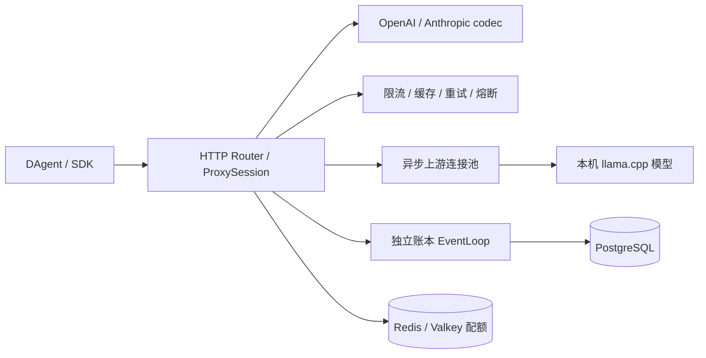

# LLMGateway

基于自研 C++23 Reactor 的本机 LLM 网关，支持 OpenAI Chat 与 Anthropic Messages 两种入口及双向转换。
**G00–G15 已完成真实验收**（G08/TLS 已移出范围）。实现、验收范围和历史问题见 [任务记录](nexttodo/implementation-tasks.md)。

## 架构与能力



| 能力 | 已验收行为 |
| --- | --- |
| 双协议 | 四种入口/上游组合的对话、SSE、工具调用及结果回传；精确 count_tokens 转发 |
| 生命周期 | 同 loop 上下游 I/O、背压、取消传播、超时、优雅排空 |
| 稳定性 | 重试、三级降级、熔断与单个半开探测 |
| 缓存 | LRU + TTL + 字节预算、流式回放、bypass/force |
| 用量 | 上游精确计量、未知值保留 null、PG 账本、Redis 日/月配额及流中截断 |
| 可观测性 | 访问日志、Prometheus、admin 快照、费用和缓存节省统计 |

模块说明：[net](docs/design/net.md)、[http](docs/design/http.md)、[proxy](docs/design/proxy.md)、[protocol](docs/design/protocol.md)、[ratelimit](docs/design/ratelimit.md)、[cache](docs/design/cache.md)、[observability](docs/design/observability.md)、[benchmark](docs/design/benchmark.md)。

## 构建与启动

```bash
cmake --preset dev
cmake --build --preset dev -j
ctest --preset dev --output-on-failure
./build/dev/llm-gateway -c home/gateway.json
```

首次构建需 GCC 13/C++23、CMake、Ninja、libssl-dev（仅 libcrypto）、libpq-dev；其他依赖由 CMake 获取。
提供 dev/release/asan/tsan 预设。本轮 dev **144 项单测通过**；真实验收材料在 `temp/G13/`、`temp/G14/`、`temp/G15/`。

默认监听 `0.0.0.0:8080`。上游按 `~/LLM/configs/*.env` 配置，由 `~/LLM/llm.sh status` 查看、`~/LLM/llm.sh start <名字>` 启动；网关不自动启动模型。

| 网关 model | 上游模型标识 | 本机入口 |
| --- | --- | --- |
| `qwen36` | `Qwen3.6-35B-A3B` | `http://127.0.0.1:10010/v1` |
| `nemotron` | `Nemotron-3.5-Lightning-30B-A3B` | `http://127.0.0.1:10011/v1` |
| `gemma4` | `gemma-4-26B-A4B-it` | `http://127.0.0.1:10012/v1` |

`qwen` 依序使用 qwen36 → nemotron → gemma4；三个独立别名只选指定模型。
`qwen-anth` 使用 Qwen3.6 原生 Anthropic 上游，`qwen-final` 用于 final 计量。旧 Qwen3.8/10009 已移除。
所有模型当前为 4 槽 × 131072 上下文，沿用各自服务端采样与思考默认值。

```bash
export GW=http://127.0.0.1:8080
export AUTH='Authorization: Bearer gk-dagent' # 仓库示例身份
curl -sN "$GW/v1/chat/completions" -H "$AUTH" -H 'Content-Type: application/json' \
  -d '{"model":"qwen","stream":true,"max_tokens":2048,"messages":[{"role":"user","content":"你好"}]}'
curl -sN "$GW/v1/messages" -H "$AUTH" -H 'Content-Type: application/json' \
  -d '{"model":"qwen","stream":true,"max_tokens":2048,"messages":[{"role":"user","content":"你好"}]}'
curl -s "$GW/v1/models" -H "$AUTH"
curl -s "$GW/healthz"
```

默认 home/gateway.json 未启用 PostgreSQL/Redis。需要账本与配额时，按 [部署与配置规格](nexttodo/usage-ledger.md#8-配置) 启动 deploy/docker-compose.yml 中的专用容器并加入相关段；密码从环境变量或 deploy/.env 读取，配置使用 `env:GW_PG_DSN`。

## DAgent 对接

`~/DAgent/home/models.json` 已备份为 `models.json.G15.bak`，加入以下配置，保留原默认模型：

```json
"gw-qwen": { "kind": "openai-chat", "base_url": "http://127.0.0.1:8080/v1", "api_key": "gk-dagent", "model": "qwen", "context_window": 131072, "max_tokens": 8192, "include_usage": true },
"gw-claude": { "kind": "anthropic", "base_url": "http://127.0.0.1:8080/v1", "api_key": "gk-dagent", "model": "qwen", "context_window": 131072, "max_tokens": 8192 }
```

启动网关后用 `dagent --model gw-qwen` 或 `dagent --model gw-claude`。
真实验收使用隔离的 DAgent home 和临时网关端口，已覆盖文件读写、多轮会话、Esc 取消、429 重试、降级、PG 用量核对及配额截断；终端截图见 `temp/G15/`。验收进程已退出，未部署常驻 8080 网关。

## 实测与边界

release：健康接口 **55.0 万 req/s / p99 2.07ms**，缓存命中 **34.7 万 req/s / p99 3.19ms**；1000 并发慢速流全部完成、RSS 峰值 28.88MiB。完整方法、TTFB 差值和背压边界见 [压测报告](docs/design/benchmark.md)。

只接受本机明文 HTTP，不接远端云模型或 TLS。跨协议图片/document、n>1、JSON response_format 尚不支持；同协议透传保留上游能力。final 上游被取消时未报告的 token 保持未知；Nemotron/Gemma4 未配置单价，费用记 0。配额按流中累计计数观测，可能出现一个分片量级的超额；不宣称绝对硬截断。
