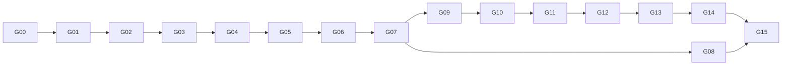

# 实施任务与真实验收

先读 [README](README.md) 的执行规则与环境准备。每个任务按"交付 → 单测 → 真实验收 → 完成标准"推进，
验收材料放 `temp/<任务编号>/`，完成后在 §6 追加执行记录。

## 1. 任务图与状态



| 编号 | 交付 | 状态 | 前置 |
| --- | --- | --- | --- |
| G00 | 环境、工程骨架、依赖、预设 | 未开始 | 无 |
| G01 | base 与 Buffer | 未开始 | G00 |
| G02 | EventLoop / Channel / EpollPoller / TimerQueue / 线程池 | 未开始 | G01 |
| G03 | Acceptor / TcpServer / TcpConnection / PlainTransport / 水位回调 | 未开始 | G02 |
| G04 | HTTP 服务端、配置加载、main、`/healthz` | 未开始 | G03 |
| G05 | 上游客户端：Resolver / Connector / 响应解析 / chunked / 连接池 | 未开始 | G04 |
| G06 | OpenAI 透传代理（非流式 + 流式）、鉴权、路由、SSE | 未开始 | G05 |
| G07 | 背压、取消传播、超时 | 未开始 | G06 |
| G08 | OpenSSL 非阻塞 TLS | 未开始 | G07 |
| G09 | 可观测性：记录、访问日志、指标、成本、admin 接口 | 未开始 | G07 |
| G10 | 限流 | 未开始 | G09 |
| G11 | 用量账本（PostgreSQL）与配额（Redis）、流式超额截断 | 未开始 | G10 + 容器已启动 |
| G12 | 故障注入上游、重试、降级、熔断 | 未开始 | G11 |
| G13 | 响应缓存 | 未开始 | G12 |
| G14 | Anthropic 入口与上游、协议转换 | 未开始 | G13 |
| G15 | DAgent 对接、压测、设计文档 | 未开始 | G08、G14 |

G08 只依赖 G07，可以和 G09–G14 穿插进行；但 G09 之后的验收里凡是用到 DeepSeek（https）的项，都要求 G08 已完成。

## 2. 通用约定

构建与运行：

```bash
cmake --preset dev && cmake --build --preset dev -j
ctest --preset dev --output-on-failure
./build/dev/llm-gateway -c home/gateway.json          # 可执行文件统一输出到 build/<preset>/
```

发请求用的环境变量（写进 `temp/env.sh`）：

```bash
export GW=http://127.0.0.1:8080
export AUTH='Authorization: Bearer gk-dagent'
export JSON='Content-Type: application/json'
```

需要改配置做验收时，复制一份到 `temp/<任务编号>/gateway.json` 再改，不改 `home/gateway.json` 的默认值。
所有验收都要保存：使用的配置、请求命令、响应（或其摘要）、网关日志片段。

## 3. 逐项任务

### G00：环境与工程骨架

交付：

- `sudo apt install -y libssl-dev libpq-dev`（两者都在 G00 装好，CMake 从一开始就找它们，不设可选开关），可选 `wrk`；
- 根 `CMakeLists.txt`、`CMakePresets.json`（dev/release/asan/tsan，含 build/test presets）、`cmake/deps.cmake`、`src/CMakeLists.txt`、`test/CMakeLists.txt`，内容见 [architecture.md §6](architecture.md#6-构建)；
- 复制 `~/DAgent/src/public/lib/nlohmann/` 到 `src/public/lib/nlohmann/`；
- `AGENTS.md`：写入 [README §3](README.md#3-执行规则) 的执行规则；`.gitignore` 加 `build/`、`temp/`、`logs/`、`data/`、`deploy/.env`；
- `home/gateway.json`：先放 [policies.md §5](policies.md#5-配置-homegatewayjson) 的示例配置。

完成标准：`cmake --preset dev` 成功，空库目标能构建，`ctest --preset dev` 能运行（0 个测试）。

### G01：base 与 Buffer

交付：`base/{noncopyable,timestamp,log,current_thread,strings}`、`net/buffer`。
- `log`：`gw::log::init(level, file)`，其余代码直接用 spdlog 宏；
- `strings`：`toLower`、`trim`、`iequals`、`splitOnce`（HTTP 头解析要用）。

单测 `buffer_test`：append/retrieve、prepend、`ensureWritableBytes` 前移与扩容、`findCRLF` 跨扩容、`readFd` 用 pipe 写入 100KB（超过 64KB 栈缓冲）后一次读全。

完成标准：单测通过，asan preset 下通过。

### G02：Reactor 核心

交付：`net/{event_loop,channel,poller,timer_queue,timer_id,event_loop_thread,event_loop_thread_pool,callbacks}`，语义见 [net-reactor.md §2–4](net-reactor.md#2-eventloop)。

单测 `timer_queue_test`（真实 loop，在单测线程里跑）：
- runAfter 顺序正确；runEvery 触发次数；
- 在回调里 cancel 自己（runEvery 不再触发）、cancel 另一个未到期定时器；
- 另一个线程 `runInLoop` 1 万次，计数正确；`quit()` 跨线程生效；
- EventLoopThreadPool(4) 的 `getNextLoop` round-robin，线程初始化回调在对应线程执行。

完成标准：单测在 dev 与 **tsan** preset 下都通过。

### G03：TCP 服务端连接

交付：`net/{inet_address,socket,acceptor,tcp_server,tcp_connection,transport}`（先只有 PlainTransport），语义见 [net-reactor.md §7–8](net-reactor.md#7-tcpconnection)。

临时验证方式：在 `llm-gateway` 的 main 里先挂一个 echo 回调（G04 替换掉，不另建 demo 目标）。

真实验收：
- `nc 127.0.0.1 8080` 回显；8 个 io 线程下 `for i in $(seq 200); do echo hi | nc -q1 127.0.0.1 8080 & done` 全部回显，日志中连接分布到不同 loop；
- 水位：把 high water 设为 64KB，用 `nc` 发送但不读取的客户端（`yes | nc 127.0.0.1 8080 > /dev/null` 配合 `kill -STOP` 暂停 nc）触发 high water 日志；`kill -CONT` 后出现 write complete 日志；
- `ulimit -n 64` 后开 100 个连接，EMFILE 处理生效且 CPU 不空转（`top` 截图）。

完成标准：以上三项有日志证据；asan 下无报告。

### G04：HTTP 服务端 + 配置 + main

交付：`http/{http_request,request_parser,response_writer,http_server,url}`、`gateway/{config,context}`、`app/main.cpp`（CLI11：`-c/--config`，`--io-threads` 覆盖配置）、signalfd 优雅退出（[architecture.md §4](architecture.md#4-优雅退出)），路由先实现 `/healthz` 与 404/405。

单测：
- `request_parser_test`：完整请求、逐字节喂入等价、pipelining 两个请求连在一起、431/413/411/400 各一例、`Expect: 100-continue`、HTTP/1.0 keep-alive 判断；
- `url_test`：[http.md §9](http.md#9-url) 的例子 + IPv6。
- 配置加载：`env:` 替换、引用不存在的上游报错（可在 `config_test` 里用临时文件）。

真实验收：
- `curl -v $GW/healthz` 200；`curl -v $GW/nope` 404；`curl -v --http1.1 $GW/healthz $GW/healthz` 看到 "Re-using existing connection"；
- `wrk -t4 -c256 -d15s $GW/healthz` 记录 QPS 与延迟（release preset），作为 G15 的基线；
- 运行中 `kill -TERM`，进程在 drain 后退出，日志完整。

### G05：上游客户端

交付：`net/{resolver,connector}`、`http/{response_parser,chunked,upstream_client,upstream_pool}`，语义见 [net-reactor.md §9–11](net-reactor.md#9-resolver)、[http.md §6–7](http.md#6-上游客户端upstreamclient)。

单测：
- `response_parser_test`：Content-Length / chunked / 连接关闭定界三种；1xx 跳过；逐字节等价；错误体截断；
- `chunked_test`：带扩展的 size 行、跨块切分、非法十六进制、trailer。

真实验收（此时还没有代理逻辑，在 main 里加一个临时的 `--probe URL` 命令行选项，发一次 GET 并打印状态与体长度；G06 完成后删除）：
- `--probe http://127.0.0.1:10010/health`、`/v1/models` 返回 200；
- `--probe http://localhost:10010/health` 走 Resolver 线程（日志显示解析耗时，第二次命中缓存）；
- 连接被拒：`--probe http://127.0.0.1:1/` 报 refused；连接超时：`--probe http://10.255.255.1/` 在 connect 超时后报 timeout；
- 连续两次 probe 同一上游，第二次 `reused=true`；等待超过 `pool_idle_seconds` 后再次 probe，`reused=false`。

### G06：OpenAI 透传代理

交付：`gateway/{auth,router,proxy_session,usage_meter}`（本任务只实现 Acquiring → AwaitHead → AwaitFirstEvent → Streaming → Done 主路径，无重试）、
`http/sse`、`proto/{neutral,openai,token_estimate}` 中透传需要的部分（OpenAI 解码器、[protocol-translation.md §6](protocol-translation.md#6-透传时的最小改写) 的改写）、`/v1/models`。
计量按 [policies.md §4](policies.md#4-token-计量) 实现：`metering: llamacpp` 的注入与删除、UsageMeter。
准入（[proxy-session.md §1](proxy-session.md#1-输入与准入)）本任务只实现第 1、2、3、7 步；其余步骤由后续任务加入：
4 限流 → G10，3a/3b 账本与配额 → G11，6 熔断与尝试计划 → G12，5 缓存 → G13。未实现的步骤直接跳过，不写占位逻辑。

单测：
- `sse_test`（与 DAgent SseParser 同样的用例：CR/LF/CRLF、BOM、注释、多行 data、逐字节等价）；OpenAI 解码器对录制样本的解码（见 G14 的样本录制方法，这里先录 OpenAI 的）；
- `usage_meter_test`：用带 `timings_per_token` 与 `return_progress` 录制的真实 Qwen3.6 流，逐事件喂入，检查每一步的累计值与样本里的字段一致，结束时等于末块 `usage`；
  截断在任意事件处时，meter 的值等于截断前最后一个 `timings`（或 `prompt_progress`）。样本录制：

  ```bash
  curl -sN http://127.0.0.1:10010/v1/chat/completions -H "$JSON" -d '{"model":"Qwen3.6-35B-A3B","stream":true,
    "stream_options":{"include_usage":true},"timings_per_token":true,"return_progress":true,
    "messages":[{"role":"user","content":"用三句话介绍 epoll"}]}' > test/unit/data/openai_metering.sse
  ```

真实验收（Qwen3.6 运行中）：

```bash
# 流式
curl -sN $GW/v1/chat/completions -H "$AUTH" -H "$JSON" \
  -d '{"model":"qwen","stream":true,"messages":[{"role":"user","content":"用三句话介绍 epoll"}]}'
# 非流式
curl -s $GW/v1/chat/completions -H "$AUTH" -H "$JSON" \
  -d '{"model":"qwen","messages":[{"role":"user","content":"1+1=?"}],"max_tokens":256}'
# 工具调用（流式）：带一个 get_weather 工具，问"北京天气"
```

- 与直连 `http://127.0.0.1:10010/v1/chat/completions`（model 改为 `Qwen3.6-35B-A3B`）的输出结构一致：role 块、reasoning_content、content、tool_calls 分片、finish_reason、`[DONE]`；
- 客户端没传 `stream_options` 时收不到 usage 块；传了 `include_usage:true` 时收到；
- 下游输出里没有 `timings`、`prompt_progress`（`grep -c`为 0）；客户端自己传 `timings_per_token:true` 时有；
- **计量精确**：客户端传 `include_usage:true`，网关日志（G09 之前先用 debug 日志）记下的 prompt/cached/completion 与客户端收到的末块 `usage` 逐一相等；
  非流式请求与响应体里的 `usage` 相等；
- 错误 key → 401；未知 model → 404；
- 上游 400 原样透传：发一个超过单槽 131072 token 的 prompt（例如用 `python3 -c` 生成约 600KB 的文本），
  llama.cpp 返回上下文超长的 400，网关不重试、状态码与 message 原样到达（DAgent 靠这段文字触发压缩）；
- 同一 curl 命令连续两个请求复用下游连接；网关日志显示第二次上游连接 `reused=true`。

### G07：背压、取消、超时

交付：[proxy-session.md §3–5](proxy-session.md#3-超时) 的全部内容。

真实验收（配置复制到 `temp/G07/gateway.json`，`high_water_bytes` 改为 4096，`stall_ms` 改为 10000）：

1. **背压**：请求长输出（"从 1 数到 3000，每个数字一行"，`max_tokens: 8000`），`curl -sN --limit-rate 300 … > /dev/null`。
   证据：网关日志的 pause/resume；暂停期间 `ss -tni '( dport = :10010 )'` 显示上游 socket 的 Recv-Q 堆积；网关 RSS（`ps -o rss= -p <pid>` 每秒采样）保持平稳。
2. **stall**：`curl -sN … | sleep 60`（管道不读，curl 被阻塞后不再读 socket）→ 约 10 秒后网关日志 `downstream_stalled`，上游连接被关闭，`/slots` 显示槽位释放。
3. **流式中取消**：`timeout 5 curl -sN …`（长输出请求）→ curl 退出后立即 `curl -s http://127.0.0.1:10010/slots | jq '.[] | {id, is_processing}'` 全部 false；
   网关日志 `cancelled`、stage=streaming、`cancel_latency_us`；llama-server 日志显示任务被取消（如果它的输出有记录）。
   **取消时的计量**：客户端请求里自己带 `timings_per_token:true`，这样 curl 保存的输出里有 timings。网关记录的 `completion_tokens`
   应当 ≥ curl 收到的最后一个 `predicted_n`，且只多出排空阶段读到的那几个；`usage_source = upstream_partial`。
4. **预填充中取消**：约 60k token 的 prompt，`timeout 2 curl …` → `completion_tokens = 0`，`prompt_computed_tokens` 等于最后一次 `prompt_progress.processed`，并且小于 prompt 总数。
5. **建连中取消**：临时上游 `base_url: http://10.255.255.1/v1`、`connect_ms: 10000`，`timeout 1 curl …` → 日志 stage=acquiring，Connector 被取消，usage 全为 0（`rejected`）。
6. **ttft 超时**：`ttft_ms` 设为 50 → 请求失败返回 504（本任务还没有重试）。
7. **进度保活**：`ttft_ms` 设为 5000，发约 60k token 的 prompt（预填充超过 5 秒）→ 因为有进度事件而正常完成，没有超时。

完成标准：7 项证据齐全；asan 下重复 1、3、5 无报告。

### G08：OpenSSL 非阻塞 TLS

交付：`net/tls`（TlsContext、TlsTransport），UpstreamPool 支持 https，语义见 [net-reactor.md §6](net-reactor.md#6-tls-传输)。

真实验收：
1. `DEEPSEEK_API_KEY=… ./build/dev/llm-gateway …`，model `smart` 流式、非流式均成功，`x-gateway-upstream: deepseek`；
2. 不设 key（或设错）→ DeepSeek 401 原样透传，不重试；
3. 证书错误分类：临时上游 `https://expired.badssl.com`、`https://wrong.host.badssl.com`、`https://self-signed.badssl.com` 均得到 `tls_verify` 且错误信息包含具体原因；
4. 会话恢复：`pool_idle_seconds: 1`，两次请求间隔 3 秒 → 第二次 `tls_resumed=true`，`tls_ms` 明显下降（记录两次数值）；
5. 背压恢复路径：对 DeepSeek 长输出用 `--limit-rate 300` 慢读，确认暂停/恢复后流不会卡住（验证 `SSL_has_pending` 处理）；
6. `final` 计量的取消：在 DeepSeek 上取消一次流式请求 → `completion_tokens = null`、`usage_complete = false`、`gateway_usage_unreported_total` 加一
   （若此时 G09 尚未完成，先用 debug 日志核对，G09 完成后补做指标部分）；
7. asan preset 下重复 1、3、4。

### G09：可观测性

交付：`gateway/{request_record,metrics,pricing,access_log,admin}`，内容见 [policies.md §3](policies.md#3-可观测性)。

真实验收：
- 一次流式请求后，`logs/access.log` 最后一行 JSON 字段齐全；`ttft_ms` 与 `curl -w '%{time_starttransfer}'` 相差在几毫秒内；
- `curl $GW/metrics` 各指标存在，计数随请求增长；用 `promtool check metrics`（如已安装）或肉眼核对格式；
- 按 pricing 手算一次请求的成本，与记录一致；
- `/admin/requests?limit=5`、`/admin/stats` 返回合理数据；取消的请求 `usage_source = upstream_partial` 且 `attempts[]` 完整；
- 记录与指标里任何地方都不出现 `token_estimate` 算出的数：把网关日志里准入时的预留量和最终记录对比，两者必须来源不同、数值无关；

### G10：限流

交付：`gateway/{token_bucket,rate_limiter}`，内容见 [policies.md §1](policies.md#1-限流)。

单测（注入假时钟）：
- `token_bucket_test`：补充速率、容量上限、大于容量的请求要求桶满、负债与恢复、`waitFor` 计算；
- `rate_limiter_test`：4 个桶任一不足即整体拒绝且不扣任何桶；结算多退少补；并发 16 线程 × 1000 次 acquire 总扣减数正确（tsan）。

真实验收（`temp/G10/gateway.json`：`gk-dagent` 的 rpm=5；模型 `qwen` 的 tpm=3000）：
- `seq 10 | xargs -P10 -I{} curl -s -o /dev/null -w '%{http_code}\n' …` → 5 个 200、5 个 429，429 带 Retry-After 与 scope 头；
- token 维度：`max_tokens: 2500` 的请求第一个通过、紧接着第二个 429（dimension=tokens）；第一个实际只用了几百 token，结算后等待更短时间即可通过；
- 取消的请求按上游报告的部分用量结算，其余预留退还（`/admin/stats` 或指标对比，差值等于记录里的真实用量）。

### G11：用量账本与配额

交付：内容见 [usage-ledger.md](usage-ledger.md)。
- `deploy/docker-compose.yml`、`deploy/.env.example`、`sql/migrations/001_init.sql`；
- `store/{resp,redis_client,pg_client}`（新库 `gw_store`）；ledger loop 线程；
- `gateway/{ledger,quota,usage_api}`；ProxySession 的准入配额检查、流式上报与截断、finish 时入账（[proxy-session.md](proxy-session.md) 中标注的步骤）。

准备（libpq-dev 已在 G00 安装）：`cp deploy/.env.example deploy/.env` 并填密码；`docker compose -f deploy/docker-compose.yml up -d`；
`export GW_PG_DSN="host=127.0.0.1 port=5433 dbname=gateway user=gateway password=…"`。

单测（不连数据库）：
- `resp_test`：简单字符串、错误、整数、空 bulk、嵌套数组、多个回复连在一起（流水线）、逐字节喂入等价；
- `quota_period_test`：按 UTC 偏移计算日/月键名、跨零点与跨月边界、到下个周期的 Retry-After 秒数；
- `usage_row_test`：UsageRow → 语句参数（NULL 字段、成本整数化、`billable_tokens` 计算、attempts JSON）。

真实验收（PG/Valkey 容器 + Qwen3.6；SQL 用 `psql "$GW_PG_DSN"` 执行）：

| # | 场景 | 证据 |
| --- | --- | --- |
| 1 | 启动两个网关实例（8080/8081，`instance_id` 不同）同时迁移 | `schema_migrations` 只有一行；两个实例都正常服务 |
| 2 | 发 20 个请求（流式、非流式、取消各几个） | `usage_records` 20 行，每行 token 数与访问日志逐一相等；取消的行 `usage_complete` 与 `attempts` 正确 |
| 3 | 汇总一致性 | 下面的核对 SQL 返回 0 行 |
| 4 | 客户端重复使用同一个 `x-request-id` 发两次 | 两行，`ledger_id` 不同 |
| 5 | `/v1/usage`、`/v1/usage/requests` 翻页 | 与 SQL 查询结果一致；`quota` 与 `valkey-cli GET` 一致 |
| 6 | 准入超额：临时配置 `daily_tokens` 小于已用量 | 429 `insufficient_quota`，Retry-After 为到本地零点的秒数 |
| 7 | 流式截断：`daily_tokens` = 已用 + 500，请求长输出 | 流以 `finish_reason:"length"` + `[DONE]` 正常结束；账本 `truncated=true`；单个流的超额量 ≤ 触发截断的那个 chunk 加排空阶段读到的量（用 PG 的 billable 与限额计算）；下一个请求 429 |
| 8 | 超大 prompt：剩余 10k，发 60k token 的 prompt | 首个 `prompt_progress` 报出总数时就判定超额，客户端直接收到 429，没有任何流内容；账本 `billable_tokens` 只含已处理的部分（通常接近 0），`input_tokens` 为 prompt 总数 |
| 9 | 多实例共享额度：两个实例上对同一个 key 并发 8 个流，限额设在中途 | 总超额在 §5.4 的上限内；全部结束后 `/admin/quota/reconcile` 差值为 0 |
| 10 | PG 故障：`docker compose stop postgres` | 新请求 503；恢复后积压写入，停机前已完成的请求在 PG 里一条不少（与访问日志行数对比） |
| 11 | Redis 故障：`docker compose stop valkey` | `on_redis_failure: reject` 时 503；改为 `allow` 时放行并计数 |
| 12 | Redis 重建：`valkey-cli FLUSHALL` 后重启网关 | 当日/当月计数从 PG 恢复，reconcile 差值为 0 |
| 13 | 压力下 SIGTERM | 退出前队列写完，PG 行数等于访问日志行数 |

```sql
-- 汇总与明细必须一致（应返回 0 行）
SELECT d.key_name, d.day, d.model, d.billable_tokens, s.billable
FROM usage_daily d
FULL JOIN (SELECT key_name, billing_day AS day, model, sum(billable_tokens) AS billable, count(*) AS n
           FROM usage_records GROUP BY 1, 2, 3) s USING (key_name, day, model)
WHERE d.billable_tokens IS DISTINCT FROM s.billable OR d.requests IS DISTINCT FROM s.n;
```

### G12：故障注入上游、重试、降级、熔断

交付：`test/fault_upstream/`（§4）、`gateway/{retry_policy,circuit_breaker}`，ProxySession 的 Backoff 状态，内容见 [proxy-session.md §6](proxy-session.md#6-重试降级与熔断)。

单测：`retry_policy_test`（退避上下界与抖动范围、Retry-After 秒数与 HTTP-date 解析、失败分类表逐项）；`circuit_breaker_test`（假时钟：阈值打开、冷却后半开只放行一个、探测成功关闭、失败冷却翻倍且有上限）。

真实验收：在 `temp/G12/gateway.json` 里为每个场景配置一个 fault 上游（故障模式写在 base_url 路径里，见 §4），模型 `fault-<场景>` 的目标链为 `[fault-<场景>, qwen36]`，
重试参数用默认值（`max_attempts: 2`），除非表里另有说明：

| # | fault 路径指令 | 期望 |
| --- | --- | --- |
| 1 | `status=503,times=1` | 200，attempts=2，upstream=fault |
| 2 | `status=429,retry_after=1,times=1` | 退避 ≥1s 后成功，attempts=2 |
| 3 | `status=429,retry_after=60` | 超过 `max_retry_after_ms`，立即降级，upstream=qwen36 |
| 4 | `status=500` | fault 上 2 次后降级，attempts=3，upstream=qwen36 |
| 5 | `status=400` | 400 透传，不重试 |
| 6 | `drop_after=0` | 200 头后首事件前断开 → 透明重试成功 |
| 7 | `drop_after=10` | 客户端收到 10 个事件 + 流内错误，没有 `[DONE]`，outcome=stream_interrupted |
| 8 | `hang_after=5`（idle_ms=3000） | 3 秒后流内错误 |
| 9 | `ttfb_ms=5000`（ttft_ms=2000） | 超时重试后降级到 qwen36 |
| 10 | 熔断：`status=500`，连续发 6 个请求 | 日志熔断打开；之后请求 attempts=1 直接走 qwen36；冷却后出现一次半开探测 |
| 11 | 取消：`rate=5,tokens=1000`，`timeout 3 curl …` | fault 日志的"peer closed"时刻与 curl 被杀时刻相差毫秒级；记录的 `completion_tokens` **等于** fault 日志里的"已发 token 数" |

计量核对（fault 的 token 数是确定的，可以做精确相等比较）：
- 场景 1、2、4、5：被拒绝的尝试在 `attempts[]` 里全部为 0、`source = rejected`；
- 场景 7：流中断的那次尝试 `completion = 10`，与 fault 日志一致；
- 场景 9：超时的那次尝试如果 fault 还没发出任何字节，就记 0；
- 请求级总量 = 各尝试之和；`gateway_wasted_tokens_total` 等于失败尝试的消耗之和。

真实模型场景：
- 模型 `qwen` 的主目标 qwen36 停掉（先确认没有其他使用者，`~/LLM/stop-qwen36.sh`）且 qwen38 运行 → 请求降级到 qwen38；
- `~/LLM/run-qwen36.sh` 启动后立即请求 → 加载期间收到 503 Loading model 被重试（日志中能看到 503 与退避），加载完成后成功或降级。

### G13：响应缓存

交付：`gateway/response_cache`，内容见 [policies.md §2](policies.md#2-响应缓存)。

单测 `lru_cache_test`：命中/未命中、LRU 淘汰顺序、字节预算、过期惰性删除、清扫、单条超限不写入、键规范化（字段顺序不同 → 同键；`user` 不同 → 同键；stream 不同 → 不同键）。

真实验收：
- `temperature: 0` 的同一请求发两次：第一次 `x-gateway-cache: MISS`，第二次 `HIT`，记录两次 latency 与 TTFT；流式与非流式各做一次；
- 不带 temperature 的请求不缓存（无 `x-gateway-cache` 头）；`x-gateway-cache: bypass` 绕过；
- `ttl_seconds: 5` → 6 秒后 MISS；`max_bytes` 调小到 64KB 后连续不同请求触发淘汰（指标可见）；
- `/metrics` 中命中率与 `gateway_cache_saved_cost_usd_total` 增长。

### G14：Anthropic 入口、上游与协议转换

交付：`proto/{anthropic,translator}`，`/v1/messages` 与 `/v1/messages/count_tokens` 路由，内容见 [protocol-translation.md](protocol-translation.md)。

样本录制（真实数据作为单测输入，放 `test/unit/data/`）：

```bash
# OpenAI 流（含 reasoning 与并行工具调用）
curl -sN http://127.0.0.1:10010/v1/chat/completions -H "$JSON" -d @temp/G14/openai_tools.json > test/unit/data/openai_tools.sse
# Anthropic 流
curl -sN http://127.0.0.1:10010/v1/messages -H "$JSON" -H 'anthropic-version: 2023-06-01' -d @temp/G14/anthropic_tools.json > test/unit/data/anthropic_tools.sse
```

单测 `translator_test`：
- 请求映射：system 提取、并行工具结果合并为一条 user 消息、tool_choice 四种、max_tokens 缺省、图片 → 错误；反方向同样；
- 流：两个录制样本分别经"解码 → 编码为另一种协议"，检查事件序列（块开关顺序、工具参数拼接后是合法 JSON、usage 累计值、finish 映射），再经对方解码器解回来，与直接解码的中立事件序列一致（往返等价）；
- 非流式响应互转；错误体互转。

真实验收：
- OpenAI 入口 → 模型 `qwen-anth`（Anthropic 上游）：普通对话、流式工具调用；
- Anthropic 入口 → 模型 `qwen`（OpenAI 上游）：同上；
- Anthropic 入口 → `qwen-anth`：透传；
- 若本机有 Python `openai` / `anthropic` SDK，用它们的流式接口读取网关输出，作为严格的格式校验（脚本放 `temp/G14/`）；
- Anthropic 入口 → `qwen`：`message_start` 与 `message_delta` 里的 `input_tokens + cache_read_input_tokens` 都等于网关记录的 `prompt_tokens`（上游报告的精确值，不是 0 也不是估算）；
- `/v1/messages/count_tokens` 经网关返回的值与直连 `http://127.0.0.1:10010/v1/messages/count_tokens` 相同。

### G15：DAgent 对接、压测、文档

**DAgent 对接**（仅改配置，改前备份 `~/DAgent/home/models.json` 并先征得确认）：在 `models` 中增加

```json
"gw-qwen":   { "kind": "openai-chat", "base_url": "http://127.0.0.1:8080/v1", "api_key": "gk-dagent", "model": "qwen",
               "context_window": 131072, "max_tokens": 8192, "include_usage": true },
"gw-claude": { "kind": "anthropic",   "base_url": "http://127.0.0.1:8080/v1", "api_key": "gk-dagent", "model": "qwen",
               "context_window": 131072, "max_tokens": 8192 }
```

`context_window` 不得超过 Qwen3.6 单槽 131072。场景（每个保存 DAgent 截图 + 网关访问日志片段）：

| # | 场景 | 证据 |
| --- | --- | --- |
| 1 | `gw-qwen` 多轮对话 + 读写文件工具调用 | 访问日志含 TTFT/token/成本；DAgent 显示 usage |
| 2 | 生成中按 Esc | 网关 `cancelled`，`/slots` 立即空闲 |
| 3 | `gk-dagent` tpm 调低到 20000 | DAgent 显示重试后成功；网关出现 429 记录 |
| 4 | 对话中停掉 qwen36（确认无他人使用） | 下一轮 DAgent 无感继续，upstream=qwen38；熔断打开后不再尝试 10010 |
| 5 | `gw-claude` 对话 + 工具调用 | Anthropic 入口 → OpenAI 上游转换全路径可用 |
| 6 | 一段 DAgent 会话结束后查 `curl -H 'Authorization: Bearer gk-dagent' $GW/v1/usage` | 本次会话的输入/输出/缓存命中 token 与 PG 明细一致 |
| 7 | 把 `gk-dagent` 的 `daily_tokens` 设在会话中途能用完的位置 | 当前回复在额度处以 finish=length 结束（记录 DAgent 实际如何呈现）；下一轮 DAgent 收到 429 `insufficient_quota`，因为 Retry-After 超过 300 秒而直接报错 |

**压测**（release preset，结果写进 `docs/design/benchmark.md`）：
- `wrk -t4 -c256 -d30s $GW/healthz`：QPS、p99；
- 缓存命中：wrk + Lua 脚本 POST 固定 `temperature:0` 请求：QPS、p99；
- 网关额外延迟：同一请求直连 Qwen3.6 与经网关各 20 次，比较 `time_starttransfer` 的中位数；
- 1000 个并发慢速流：fault 上游 `rate=2,tokens=100`，`seq 1000 | xargs -P1000 …` 发起，采样网关 RSS、CPU、`gateway_active_streams`；
- 慢读者：100 个 `--limit-rate 200` 客户端，确认 RSS 上界约等于 100 × high_water。

**文档**：`docs/design/{net,tls,http,proxy,protocol,ratelimit,cache,observability,benchmark}.md`（写实现要点与实测数据），根目录 README（架构图、能力表、快速开始、DAgent 接入方法）。

## 4. 故障注入上游 fault_upstream

基于本项目的 Reactor 与 HTTP 服务端实现（同时也是对它们的又一次真实使用）。

```bash
./build/dev/fault-upstream --listen 127.0.0.1:19000 --threads 2
```

故障模式写在**路径前缀**里，网关侧只需要把上游的 base_url 配成对应前缀，不需要转发任何特殊请求头：

```text
POST /f/<指令,指令,...>/v1/chat/completions      → 输出 OpenAI 格式
POST /f/<指令,指令,...>/v1/messages              → 输出 Anthropic 格式
POST /v1/chat/completions                        → 无故障，正常输出
```

| 指令 | 含义 |
| --- | --- |
| `status=N` | 直接返回状态码 N，错误体按对应协议格式 |
| `times=K` | 同一个 `x-request-id` 的前 K 次请求故障，之后正常（默认一直故障）；状态按 request id 保存 60 秒 |
| `retry_after=S` | 附带 `Retry-After: S` |
| `ttfb_ms=M` | 延迟 M 毫秒再发响应头 |
| `close_before_head` | 读完请求后直接关闭连接 |
| `tokens=N` | 输出 N 个文本增量（默认 50，内容 `tok0 tok1 …`） |
| `rate=R` | 每秒 R 个事件（默认不限速） |
| `drop_after=K` | 发出 K 个事件后直接关闭连接（不发结束标记） |
| `hang_after=K` | 发出 K 个事件后停止发送但保持连接 |
| `error_after=K` | 发出 K 个事件后发送流内 error 事件并结束 |

- 自带确定性"分词"：prompt token = 所有消息文本按空白切分的词数，每个文本增量 = 1 个 token；
  支持 `timings_per_token` 与 `return_progress`，字段格式与 llama.cpp 相同，所以网关按 `metering: llamacpp` 对接它；
- 非流式请求返回完整 JSON 与按上述规则计算的 `usage`；
- 日志里记录每个请求实际发出的 token 数，作为网关计量的对照；
- 日志：每个连接的建立/关闭时刻（`CLOCK_REALTIME` 毫秒）、request id、已发事件数、"peer closed while streaming" 标记——这是取消传播延迟的对照依据；
- 响应头 `x-fault-served: <指令>` 方便在网关日志里核对。

## 5. 单测清单汇总

| 文件 | 任务 | 覆盖 |
| --- | --- | --- |
| `buffer_test` | G01 | Buffer 各操作、readFd |
| `timer_queue_test` | G02 | 定时器、跨线程任务、线程池 |
| `request_parser_test`、`url_test`、`config_test` | G04 | |
| `response_parser_test`、`chunked_test` | G05 | |
| `sse_test`、`usage_meter_test` | G06 | usage_meter 基于录制的真实流 |
| `token_bucket_test`、`rate_limiter_test` | G10 | |
| `resp_test`、`quota_period_test`、`usage_row_test` | G11 | 不连数据库；数据库行为只做真实验收 |
| `retry_policy_test`、`circuit_breaker_test` | G12 | |
| `lru_cache_test` | G13 | |
| `translator_test` | G14 | 基于录制的真实样本 |

所有解析器类单测都必须包含"逐字节喂入与整段喂入结果一致"的用例。

## 6. 执行记录

每个任务完成后追加一节：

```markdown
### Gxx：<名称>（YYYY-MM-DD）
- 完成内容：
- 构建：dev / asan / tsan 结果
- 单测：通过数 / 总数
- 真实验收：逐项结果与证据路径（temp/Gxx/…）
- 偏离规格之处及原因：
- 遗留项与下一任务：
```
