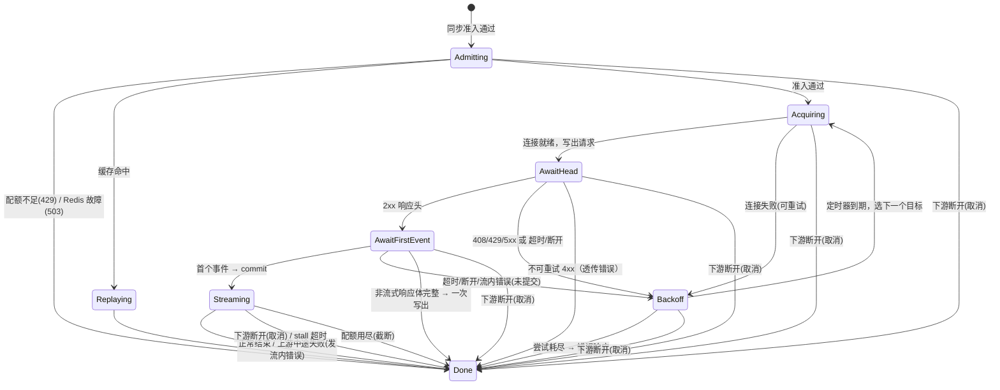

# ProxySession：一次代理请求的状态机

`gateway/proxy_session.hpp`。一个 ProxySession 对应下游的一个 HTTP 请求，从请求体收齐开始，到下游响应写完（或被取消）结束。
它只在所属下游连接的 io loop 线程上运行，不加锁。

## 1. 输入与准入

HttpServer 收齐请求后构造：

```cpp
struct IngressRequest {
    proto::Protocol protocol;        // openai | anthropic（由路由决定）
    std::string request_id;          // 客户端的 x-request-id，没有则生成（16 字节随机十六进制）
    Timestamp received_at;           // 请求体收齐的时刻 —— TTFT 与延迟的起点
    HttpRequest http;
};
```

准入按顺序执行（3b 需要等 Redis 回复，其余同步完成），任一步失败直接回错误响应（格式见 [http.md §5](http.md#5-错误体格式按入口协议)）并 finish：

| 步 | 动作 | 失败 |
| --- | --- | --- |
| 1 | 鉴权：`Authorization: Bearer` 或 `x-api-key` → `User`（先鉴权，未授权的请求不解析请求体） | 401 |
| 2 | 解析 JSON；取 `model`、`stream`、`max_tokens`（Anthropic 必填）、`temperature` | 400 |
| 3 | 路由：模型别名 → `ModelRoute`（目标链、重试参数、限流参数） | 404 |
| 3a | 账本健康：`LedgerWriter::healthy()` | 503（计费不可用时拒绝服务，[usage-ledger.md §4.4](usage-ledger.md#44-ledgerwriter)） |
| 3b | 配额（**仅对配置了 `quota` 的 key**；其他 key 跳过这一步、不进入 `Admitting`）：`EVALSHA quota_get`（**异步**，状态 `Admitting`，超时 `redis.command_timeout_ms`）→ 记下 `remaining` | 429 `insufficient_quota`；Redis 故障按 `on_redis_failure`：`reject` → 503，`allow` → 放行且本请求 `remaining = +∞`（不截断，照常尝试上报）（[usage-ledger.md §5.3](usage-ledger.md#53-三个检查点)） |
| 4 | 限流：计算预留量 → `RateLimiter::tryAcquire(user, model, reserve)` → `Ticket`（预留不是消耗，见 [policies.md §4.1](policies.md#41-原则)） | 429 + Retry-After |
| 5 | 缓存：可缓存时 `ResponseCache::get(key)`，命中 → 回放 → finish(`cache_hit`) | — |
| 6 | 生成尝试计划：目标链中跳过处于熔断打开的目标 | 全部熔断 → 503 |
| 7 | 进入 `Acquiring` 开始第一次尝试 | — |

限流在缓存之前：缓存命中也消耗请求数配额（防止刷缓存），但命中后按 0 个 token 结算，退还预留的 token 额度。

## 2. 状态

| 状态 | 含义 | 活跃定时器 |
| --- | --- | --- |
| `Admitting` | 等待 Redis 配额查询的回复 | redis 命令超时 |
| `Acquiring` | 从连接池取连接（可能要解析 DNS、建连） | connect |
| `AwaitHead` | 请求已写出，等上游响应头 | ttft |
| `AwaitFirstEvent` | 上游 2xx 响应头已到，流式请求在等第一个 SSE 事件（非流式在读整个响应体） | ttft（非流式：total） |
| `Streaming` | 已向下游提交（写出了状态行），逐事件转发 | idle（上游）、stall（仅背压暂停时） |
| `Backoff` | 本次尝试失败，等退避定时器后再试 | backoff |
| `Replaying` | 缓存命中，正在写出缓存内容 | — |
| `Done` | 已 finish，所有资源已释放 | — |

**提交点（commit）**：向下游写出第一个字节（状态行）的那一刻。提交前的任何失败都可以重试或降级，客户端毫无感知；
提交后只能在流内报错。流式请求在收到**第一个完整 SSE 事件**时才提交（而不是在上游 2xx 响应头到达时提交），
这样"上游返回 200 但第一个事件之前就断开"的情况也能透明重试。



## 3. 超时

| 名称 | 默认 | 起止 | 超时后 |
| --- | --- | --- | --- |
| `connect_ms` | 10000 | 开始取连接 → 连接可用（含 DNS、TCP） | 按可重试失败处理 |
| `ttft_ms` | 90000 | 请求写出 → 流式首个事件 / 非流式响应头 | 可重试失败 |
| `idle_ms` | 60000 | Streaming 中相邻两次收到上游字节（SSE 注释也算）；**背压暂停期间停表**，恢复读时重新计时 | 提交后：流内错误并结束 |
| `total_ms`（非流式） | 600000 | 请求写出 → 响应体完整 | 可重试失败 |
| `stall_ms` | 60000 | 因背压暂停上游读取开始 → 恢复 | 两端都关闭，finish(`downstream_stalled`) |
| `precommit_ms`（整个请求） | 100000 | received_at → commit | 立即中止当前尝试（`abortAndDrain`），不再开始新的尝试，按 §6.2 的最后一次失败返回错误 |

每个上游可在配置里覆盖这些值。

- `metering: llamacpp` 的上游会发 `prompt_progress` 进度事件（[policies.md §4.2](policies.md#42-上游计量能力-metering)）。
  收到第一个进度事件后，上游已经确认在处理，此后 ttft 定时器改为按 `idle_ms` 计时（每个进度事件重置一次）。
  长上下文预填充不会再被误判为超时，也不需要把 `ttft_ms` 设得很大。进度事件不是首 token，**不触发 commit**，也不转发给下游。
- 其他上游在预填充期间完全没有字节，`ttft_ms` 要大于最长预填充时间。
- 在进入 Streaming 之前，下游一直收不到字节。`precommit_ms`（默认 100s）是提交前所有尝试、退避、预填充加在一起的上限，
  必须小于客户端的空闲超时（DAgent 为 120s），否则客户端先断开，网关的重试就没有意义了。
  已知限制：预填充本身超过 `precommit_ms` 的请求会失败。直连 llama.cpp 时 DAgent 同样会在 120s 无字节后超时，所以这不比直连更差。
- 流式进入 Streaming 之后没有总时长上限，由 `idle_ms` 与 `stall_ms` 兜底。

## 4. 流式转发与背压

### 4.1 转发

1. `UpstreamExchange::onBody(data)` → 喂给 `SseParser`（上游是 Anthropic 或 OpenAI 都是 SSE）。
2. 每个完整事件交给**流处理器**：
   - 所有事件先喂给本次尝试的 UsageMeter（[policies.md §4.3](policies.md#43-usagemeter)）；
     meter 更新后做配额判断与上报（[usage-ledger.md §5.4](usage-ledger.md#54-流式中的上报与截断判断)）：超额时未提交 → 429，已提交 → 截断（[usage-ledger.md §6](usage-ledger.md#6-截断的行为)）；
   - 同协议透传：`PassthroughObserver` 观察（判断首 token、识别结束标记），删掉网关注入的计量字段（客户端自己请求了则保留），
     然后按 [http.md §8.2](http.md#82-写出) 重新格式化；只含进度的事件整个丢弃；
   - 跨协议：`StreamTranslator` 把上游事件转成 0..N 个入口协议事件（见 [protocol-translation.md §4](protocol-translation.md#4-流式事件转换)）。
3. 首个**要转发给下游的**事件到达时 commit：`writeStreamHead(200, headers)`，状态转 Streaming（进度事件和被丢弃的事件不算）。
4. 格式化后的字节 `writeChunk`；需要缓存时同时追加到缓存暂存区（超过单条上限就放弃缓存本次响应）。
5. 结束标记（OpenAI `data: [DONE]`，Anthropic `message_stop`）→ `endStream()` → finish(`ok`)。
   上游连接在 onComplete 后才归还连接池；如果结束标记之后连接还没读完 chunked 末块，就等 onComplete。

### 4.2 背压规则

```text
下游输出缓冲 ≥ high_water_bytes（默认 256KB）
   → HighWaterMark 回调 → exchange.pauseReading()（上游关读关注）
   → 启动 stall 定时器，记录 pause 开始时间，metrics.backpressure_active++
下游输出缓冲写空
   → WriteComplete 回调 → 若处于暂停：exchange.resumeReading()
   → 取消 stall 定时器，累计暂停时长，metrics.backpressure_active--
stall 定时器到期
   → 下游长时间不读：上游 abortAndDrain（§5.2）→ finish(downstream_stalled) → 最后 forceClose 下游
```

- stall 的收尾顺序是锁定的：**先 finish 再关下游**。关下游会同步触发下游 close 回调，回调里看到会话已结束就什么都不做；
  顺序反过来的话，close 回调会先把请求 `cancel()` 掉，记录变成 `outcome=cancelled`。验收以 finish 记录里的 `outcome` 为准，不以 WARN 日志为准。

- 为什么这样就能约束内存：暂停读后，上游数据先堆在内核 socket 接收缓冲，满了之后 TCP 窗口归零，上游服务端的发送被阻塞。
  网关的用户态内存上限约为"每个流一个高水位 + 一次读取量（64KB）"。
- 暂停期间 idle 定时器也要暂停，否则会把"我们自己不读"误判为"上游卡住"。
- 当前 Qwen3.6 输出速度下，正常客户端几乎不会触发背压；验收用 `curl --limit-rate` 人为制造慢读者，
  或者把 `high_water_bytes` 临时调到 4KB 让它更容易触发。

## 5. 取消传播

### 5.1 触发源

| 触发 | 检测方式 |
| --- | --- |
| 客户端主动断开（DAgent 按 Esc、curl Ctrl-C） | 下游 read 返回 0 / `EPOLLRDHUP` / `EPOLLHUP` |
| 写下游失败 | `EPIPE` / `ECONNRESET` |
| 下游 stall 超时 | §4.2 |
| 网关退出超时 | [architecture.md §4](architecture.md#4-优雅退出) |

下游连接的 close 回调里：若 `HttpConnState` 有进行中的 ProxySession → `session->cancel(reason)`。

### 5.2 各状态下的动作

| 状态 | 动作 |
| --- | --- |
| Acquiring | `AcquireHandle::cancel()`：停止 Connector；Resolver 的结果到达后被丢弃；正在握手的连接关闭 |
| AwaitHead / AwaitFirstEvent / Streaming | `exchange.abortAndDrain()`：① `shutdown(SHUT_WR)`，上游立刻看到 FIN 并停止生成；② 非阻塞读出 socket 里已到达的全部字节（上限 1MB），只喂 SSE 解析器与 UsageMeter，不转发；③ `close()`。**不归还连接池** |
| Admitting | 什么都不用做，Redis 回复到达后被丢弃 |
| Backoff | 取消退避定时器（上一次尝试的计量已在它结束时完成） |
| Replaying | 什么都不用做 |

第 ② 步的目的是拿到上游最后发出的累计计数，细节见 [policies.md §4.5](policies.md#45-取消时拿到最后的精确计数)。
提交后的上游中断、idle 超时、提交前的超时，也用同一个 `abortAndDrain()` 结束当前尝试。

然后 `finish(cancelled)`：

- 计量：当前尝试的 UsageMeter 取最后值（`upstream_partial`，缺字段则 `unreported`），与之前各次尝试相加（[policies.md §4.6](policies.md#46-请求级汇总与成本)）；
- 限流结算：按上游报告的真实总量结算；未报告的部分不退还预留；
- RequestRecord：`outcome=cancelled`、`cancel_stage`、`cancel_latency_us`（从检测到下游断开，到向上游发出 FIN 为止。两者在同一个线程里同步完成，应在几十微秒内）；
- 不写缓存。

### 5.3 为什么关闭上游连接就能止损

llama.cpp 在流式生成时检查 `is_connection_closed`，发现连接关闭就中止任务、释放槽位。
网关在同一个 loop 线程上同步完成"发现下游断开 → 向上游发 FIN → 读完已到达的数据 → 关闭上游 fd"，中间没有线程切换和排队。验收时用 `GET :10010/slots` 看槽位的 `is_processing` 立即变为 false。

## 6. 重试、降级与熔断

### 6.1 失败分类

| 失败 | 可重试 | 计入熔断 | 备注 |
| --- | --- | --- | --- |
| DNS 失败 | 是 | 是 | |
| 连接被拒 / 不可达 / 连接超时 | 是 | 是 | 典型场景：上游进程没启动 |
| 读写 IO 错误（ECONNRESET 等） | 是 | 是 | |
| 复用连接在收到任何字节前断开 | 立即新建连接重发一次，**不计入**尝试次数 | 否 | [net-reactor.md §11](net-reactor.md#11-upstreampoolgw_http每-loop-一个) |
| 响应头前断开 / ttft 超时 | 是 | 是 | |
| HTTP 408、409、425 | 是 | 否 | |
| HTTP 429 | 是 | 否（是上游配额问题，不是故障） | 尊重 Retry-After |
| HTTP 500、502、503、504、529 | 是 | 是 | llama.cpp 模型加载中返回 503 |
| 其他 4xx（400、401、403、404、413、422…） | 否 | 否 | 直接透传给客户端 |
| 2xx 但提交前流中断 / 首事件前流内出现 error 事件 | 是 | 是 | |
| 提交后流中断 / idle 超时 | 否（已提交） | 是 | 发送流内错误后结束 |

### 6.2 尝试计划

```text
targets = route.targets 中未熔断的（半开状态的目标只允许一个探测请求进入）
for target in targets:                                 # 降级 = 换下一个目标
    for attempt in 1..target.retry.max_attempts:       # 默认 2（首次 + 1 次重试）
        若已超过 precommit_ms：停止
        结果 = 发起尝试(target)
        成功 / 不可重试 → 结束
        若失败是"证书校验失败"或 Retry-After > retry.max_retry_after_ms：break（直接降级）
        若还有下一次尝试：Backoff(delay) 后继续
全部失败 → 按最后一次失败返回错误：
    最后一次是上游 HTTP 状态（429/5xx）→ 原样返回该状态码与错误体（跨协议时转换格式），保留上游的 Retry-After 头
    最后一次是超时（connect/ttft/total/precommit）→ 504
    最后一次是其他传输失败（DNS、连接被拒、断开）→ 502
```

- 退避：`delay = min(max_ms, base_ms × 2^(n-1)) × U(0.8, 1.2)`；有 Retry-After（秒或 HTTP-date）时 `delay = max(delay, retry_after)`。
- 默认 `base_ms=500`、`max_ms=8000`、`max_retry_after_ms=10000`。
- 限流预扣的 Ticket 在多次尝试间保持不变；降级到另一个目标时**模型维度的限流按别名计**，不重新扣。
- 响应头 `x-gateway-upstream: <实际服务的上游名>`、`x-gateway-attempts: <总尝试次数>`。
- 为什么重试间隔用定时器：Backoff 期间 io 线程继续服务其他连接，绝不能 sleep。

### 6.3 提交后的上游失败

| 入口协议 | 流内错误事件 | 之后 |
| --- | --- | --- |
| OpenAI | `data: {"error":{"message":"upstream stream interrupted: …","type":"upstream_error"}}` | 不发 `[DONE]`，`endStream()` |
| Anthropic | `event: error` + `data: {"type":"error","error":{"type":"api_error","message":"…"}}` | `endStream()` |

不发正常结束标记是有意的：DAgent 把"流缺少结束事件"视为可重试失败，会自己丢掉半截回复并重试整个请求。

### 6.4 熔断器（每个上游一个，跨线程共享）

| 状态 | 规则 |
| --- | --- |
| closed | 统计连续失败；达到 `failure_threshold`（默认 5）→ open |
| open | 持续 `cooldown_ms`（默认 30000），期间路由直接跳过该上游 |
| half_open | 冷却结束后放行**一个**探测请求：成功 → closed；失败 → open（冷却时间翻倍，上限 5 分钟） |

熔断状态变化打印运行日志，并反映在 `/metrics` 的 `gateway_upstream_circuit_state{upstream}`（0/1/2）。

## 7. 非流式请求

- 上游请求不带 `stream: true`（跨协议时由 Translator 保证）；读完整响应体（上限 `max_upstream_body_bytes`，默认 16MB）。
- 2xx：同协议原样返回响应体；跨协议经 Translator 转换；从响应体取 usage。一次 `writeFull` 就是提交点，因此非流式在写出之前都可以重试。
- TTFT 对非流式请求不适用（记录为 null），只记录总延迟与上游首字节时间（TTFB）。

## 8. finish(Outcome)

所有路径都通过 `finish` 收口（幂等，第二次调用直接返回）：

1. 取消所有定时器；
2. 上游连接：可复用则 `pool.release(lease)`，否则 `forceClose`；
3. 汇总各次尝试的 AttemptUsage，`RateLimiter::settle(ticket, 上游报告的真实总量)`（[policies.md §4.6](policies.md#46-请求级汇总与成本)）；
   把尚未上报的配额增量 `quota_add` 补上（**发出即可，不等回复**，失败只计数，见 [usage-ledger.md §5.5](usage-ledger.md#55-redis-故障与重建)）；`LedgerWriter::submit(UsageRow)` 入账（[usage-ledger.md §4.4](usage-ledger.md#44-ledgerwriter)）——**鉴权通过后的每个请求都入账**，包括被配额/限流拒绝、取消、失败、缓存命中的请求（它们的 billable 可能为 0，但要留痕）；
4. 可缓存且结果为 `ok` → `ResponseCache::put`；
5. 熔断：按最后一次尝试结果 `recordSuccess/recordFailure`（每次尝试结束时就已上报，这里不重复）；
6. 填写 RequestRecord（[policies.md §3.1](policies.md#31-requestrecord)），`Metrics::observe(record)`，`AccessLog::write(record)`，`RecentRequests::push(record)`；
7. 下游连接：非 keep-alive 或已出错 → `shutdown()`；否则 `HttpConnState` 解除当前会话并继续解析缓冲里的下一个请求。

Outcome 取值：`ok`、`cache_hit`、`upstream_error`（透传的 4xx 或耗尽后返回的 5xx）、`rate_limited`、`bad_request`、`unauthorized`、
`cancelled`、`downstream_stalled`、`stream_interrupted`（提交后中断）、`unavailable`（全部熔断/退出中/账本或 Redis 不可用）、
`quota_exceeded`（准入或提交前超额，429）、`quota_truncated`（流式中超额截断）。
